<p align="center"></p>

# Harmonic Signal Alerts (MetaTrader 5 and MetaTrader 4)

A free indicator that finds **ABCD, Gartley and Bat** harmonic patterns, draws the XABCD lines, the reversal zone and an
arrow when price reaches the zone, **from confirmed swings and closed bars only**, and sends an alert. Source for both
editions, a Python reference of the rules, and the tests that were used to check that the MT5 and MT4 code, the Python
reference and each other all agree.

**Website:** [allanninal.dev/mql5 (indicators)](https://www.allanninal.dev/mql5/#indicators) · [MT4 editions](https://www.allanninal.dev/mql5/#mt4) · [allanninal.dev](https://www.allanninal.dev)
· **Contact:** message me on [LinkedIn](https://www.linkedin.com/in/allanninal/).

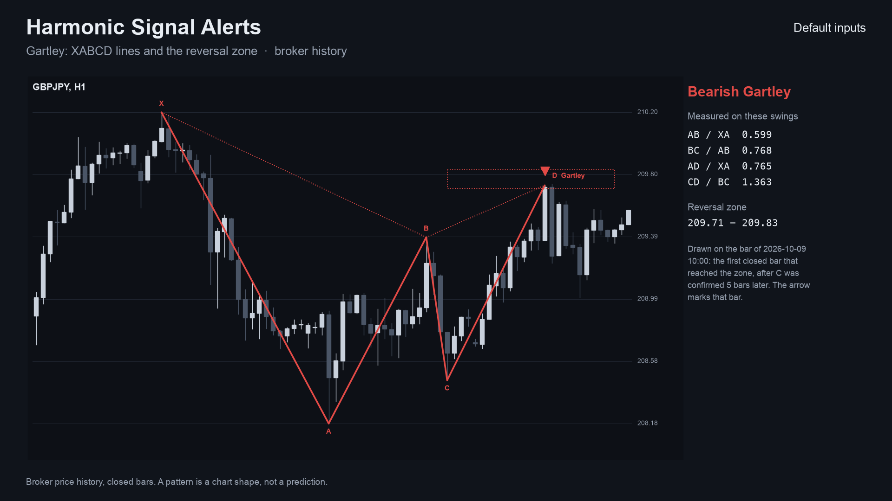

> It is an indicator, not a strategy. It draws a pattern and places no trades. A harmonic pattern is a chart shape, not a
> prediction. Nothing here is a profit claim (see [Honest limits](#honest-limits)).

## Get it on the MQL5 Market

| Edition | Platform | Price | Link |
|---|---|---|---|
| Harmonic Signal Alerts | MT5 | free | <https://www.mql5.com/en/market/product/201811> |
| Harmonic Signal Alerts MT4 | MT4 | free | <https://www.mql5.com/en/market/product/202361> |
| Harmonic Scanner | MT5 | paid | <https://www.mql5.com/en/market/product/201814> |
| Harmonic Scanner Pro MT4 | MT4 | paid | <https://www.mql5.com/en/market/product/202421> |

The Market builds are the same calculation as the source in this repository. The two scanner editions are a separate,
paid product that is **not** part of this repository (see [Free vs Pro](#free-vs-pro)).

## Contents

1. [What it is and who it is for](#what-it-is-and-who-it-is-for)
2. [Why it was built](#why-it-was-built)
3. [How it works](#how-it-works)
4. [Non-repainting: the proof and how it was tested](#non-repainting-the-proof-and-how-it-was-tested)
5. [Architecture and buffers](#architecture-and-buffers)
6. [Inputs, alerts, install and compile](#inputs-alerts-install-and-compile)
7. [Run the Python reference and the tests](#run-the-python-reference-and-the-tests)
8. [Honest limits](#honest-limits)
9. [Free vs Pro](#free-vs-pro)
10. [Licence](#licence)

## What it is and who it is for

**What:** the harmonic patterns that need only four or five swing points (X, A, B, C and the completion point D) and
Fibonacci ratios between their legs. When a closed bar first reaches a pattern's **potential reversal zone (PRZ)**, the
indicator draws the XABCD lines with point labels, the zone as a box and an arrow (green up for a bullish pattern, red
down for a bearish one) on that bar. Alerts: pop-up (on by default), sound, push notification, e-mail.

**For:** traders who use harmonic patterns and want them found by fixed, readable rules instead of drawn by hand. Also
for developers who want a small, tested swing-and-ratio engine with documented buffers to read from an EA with `iCustom`.

**Not for:** anyone who expects a pattern to predict a reversal. It shows that price reached a zone whose geometry matches.

| | |
|---|---|
| 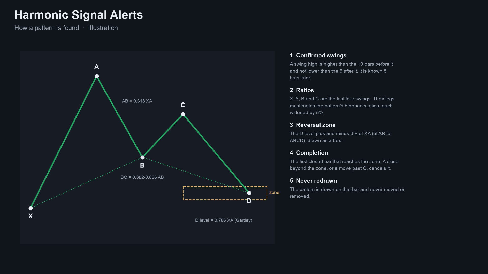 | 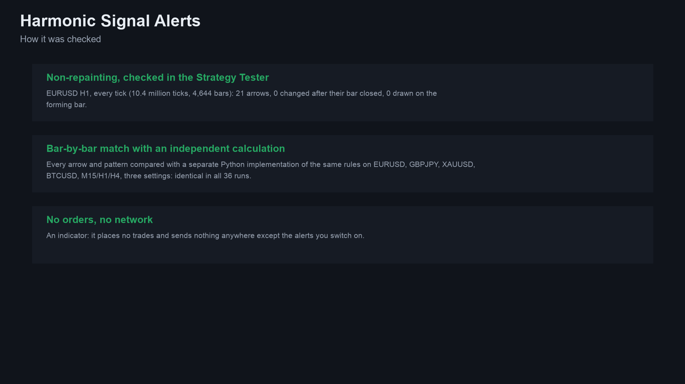 |
| 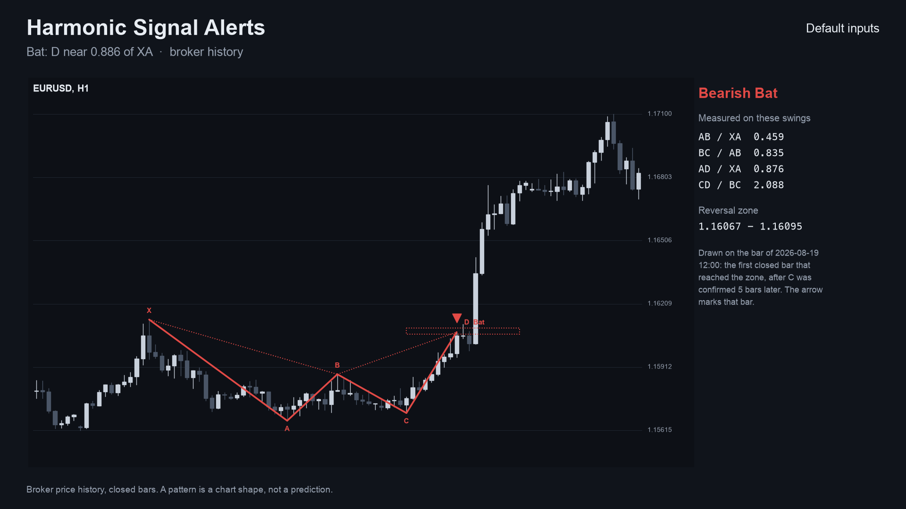 | 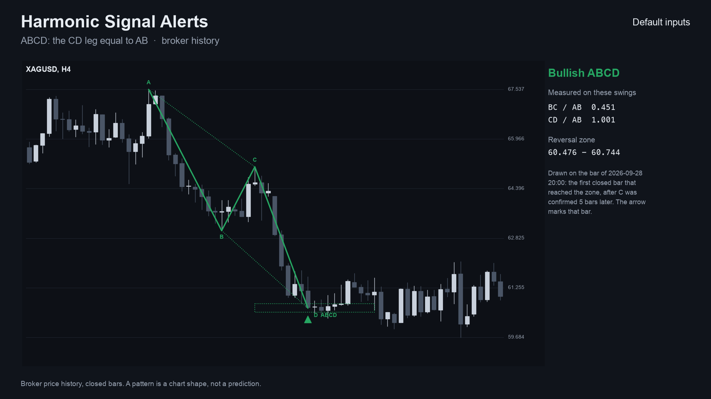 |
| 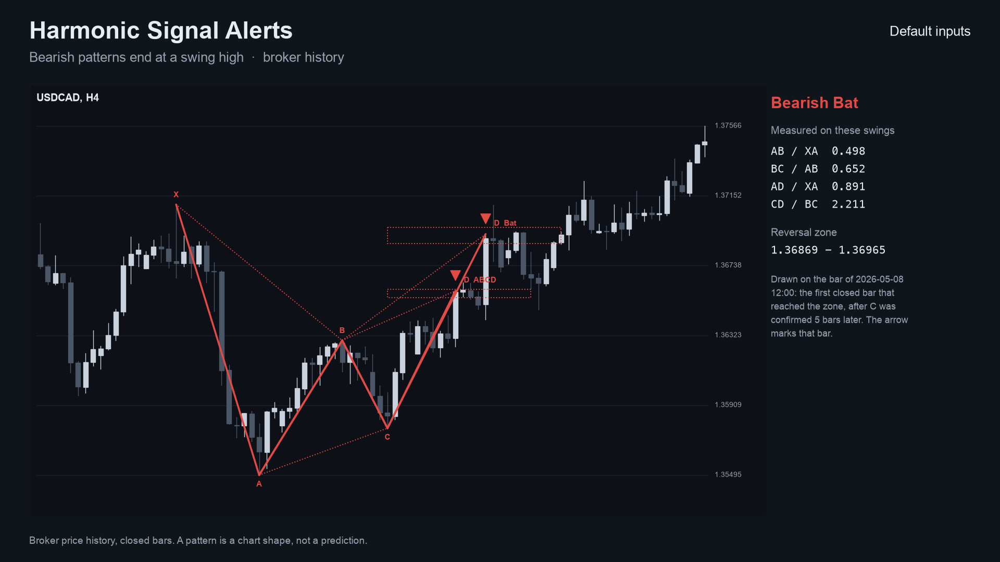 | 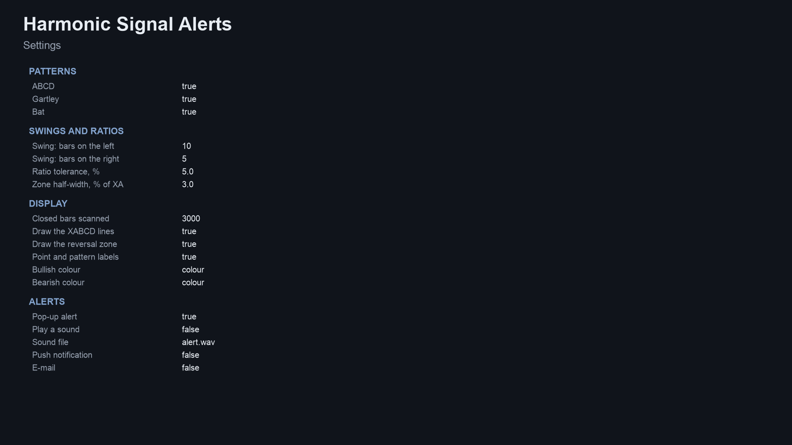 |

Image notes: the charts are drawn by the Python reference on broker price history (the same patterns the indicator
shows); the explanation, checks and settings sheets are illustrations, not terminal captures. MT4 versions are in
[`docs/images/mt4/`](docs/images/mt4).

## Why it was built

Harmonic patterns are a well-known method, but most tools that draw them are closed boxes, repaint, or draw a pattern
into the past once the swings later move. The motivations, stated with the evidence we actually have:

- **Confirmed swings only.** A pivot is only used once the bars to its right have closed, so a pattern is drawn on the bar
  where it became known and never moves. This is the design rule that matters most for trust.
- **Readable rules.** The ratios are the commonly published Carney values; every comparison is in
  [`tests/reference.py`](tests/reference.py) and in the `.mqh` engine.
- **Honest scale of demand.** Our market research (MQL5 Market, TradingView, forums and freelance boards, October 2026)
  found harmonic scanners are requested and sold (on the order of 90 harmonic indicators on the MQL5 Market, about 16 of
  them free) but is a niche with several established products. This is a free tool with a clean, tested reference
  implementation, not a claim of unmet demand.
- **Provable behaviour.** Every number in this README comes from an executed check, listed below.

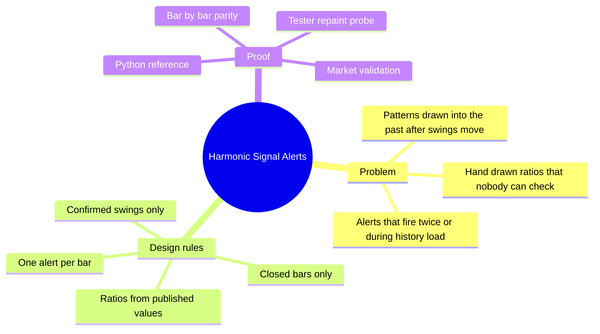

## How it works

### Swings (non-repainting)

A **pivot high** at bar `p` has a high above each of the `left` bars before it (default 10) and not below any of the
`right` bars after it (default 5), so it is known `right` bars later, on the bar that confirms it. A pivot low mirrors it.
The swing list alternates high and low:

- a pivot of the same type as the last swing **replaces** it only when it is more extreme;
- a pivot on the wrong side of the last swing (a low at or above the last high, or the reverse) is ignored;
- a bar that is both a pivot high and a pivot low adds only the type that alternates.

### The patterns

For a **bullish** pattern the swings are X low, A high, B low, C high and D below C; a bearish pattern mirrors it. Ratios
use the legs `XA`, `AB`, `BC`, `CD`. Every range end and single value is widened by the tolerance `tol` (default 5%): a value
`v` matches the range `[lo, hi]` if `lo x (1 - tol) <= v <= hi x (1 + tol)`.

| Pattern | AB / XA | BC / AB | D level (key) | CD / BC at the key level |
|---|---|---|---|---|
| ABCD | not used | 0.382 to 0.886 | `C -/+ AB` (CD = AB) | not used |
| Gartley | 0.618 | 0.382 to 0.886 | `A -/+ 0.786 XA` | 1.13 to 1.618 |
| Bat | 0.382 to 0.50 | 0.382 to 0.886 | `A -/+ 0.886 XA` | 1.618 to 2.618 |

For ABCD only three swings (A, B, C) are needed. A candidate also needs its key level to lie beyond C
(`sign x (C - key) > 0`).

### The reversal zone, completion and void

- Scale `S = XA` (ABCD: `AB`). The **PRZ** is the key level `+/- prz x S` (default 3%): a *near* edge towards C and a
  *far* edge.
- A candidate lives while its C is the last swing. Each closed bar from C's confirmation on: a bar whose high (bullish) or
  low (bearish) goes **beyond C** ends it.
- **Completion** is the first closed bar on which the lowest low since C (bullish) reaches the near edge. If any **close**
  since C is beyond the far edge by then, the pattern is **void** (price overshot), and nothing is drawn.
- The event is dated on the bar it became known, never back-dated. `D` is drawn at the extreme since C.

### Per-bar algorithm

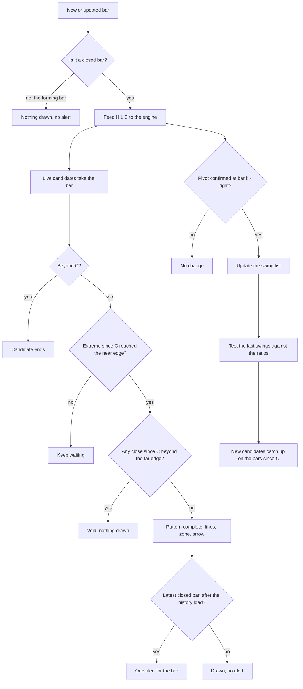

### Signal states

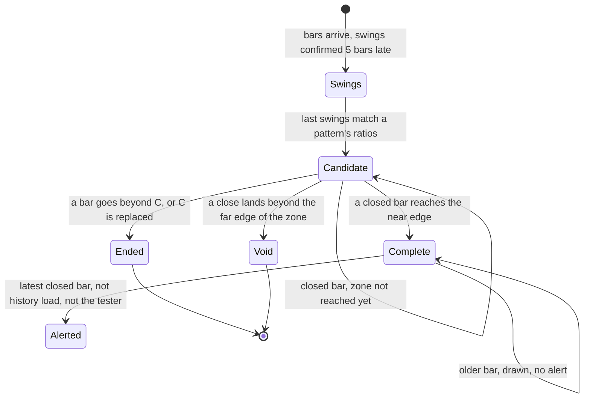

### Alert flow

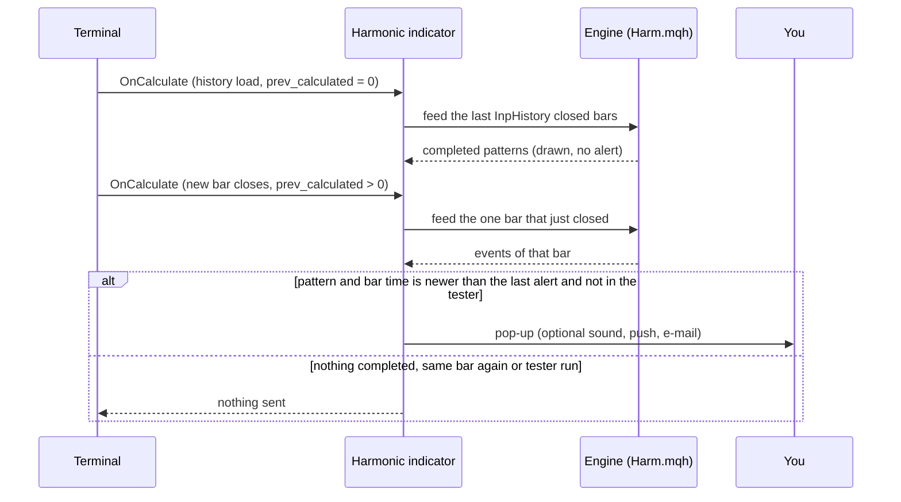

### How often patterns complete (measured)

Completed patterns per 1,000 closed bars, default inputs, on broker history of EURUSD, GBPJPY, XAUUSD and BTCUSD (H1:
374,992 bars, up to 100,000 per symbol; H4: 103,893; M15: 25,764 because the M15 history in the tester was shorter). It
counts patterns only. It says nothing about what price does afterwards. Source:
[`docs/data/pattern-frequency.json`](docs/data/pattern-frequency.json), made by [`tests/frequency.py`](tests/frequency.py).

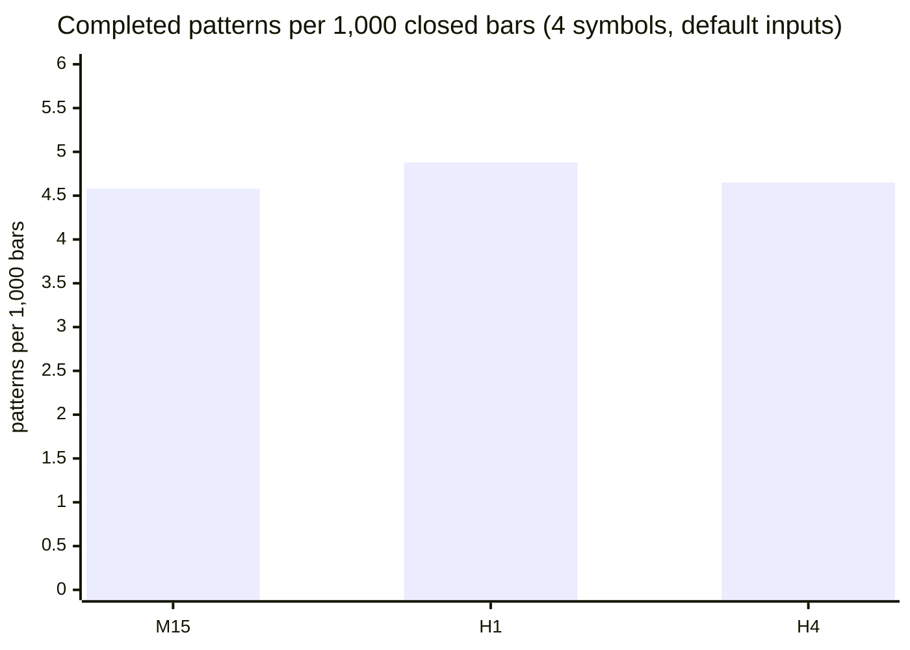

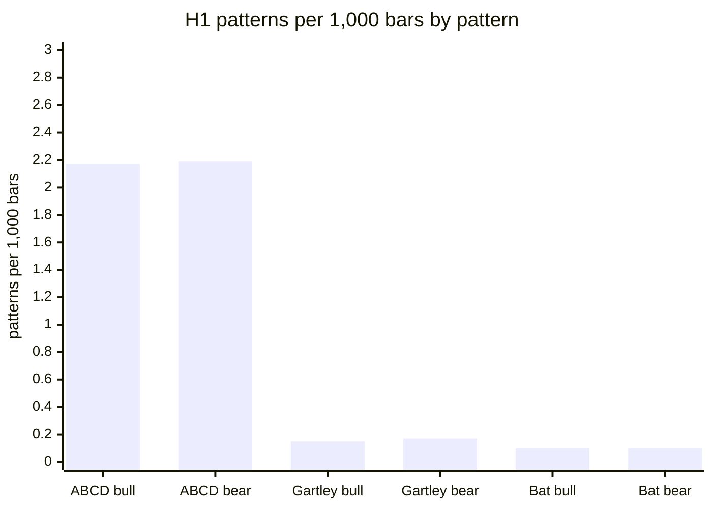

About one pattern per 205 H1 bars over the four symbols (an average of 2 to 3 per symbol per month on H1). ABCD is far
more common than Gartley or Bat because it has the loosest conditions. These are rare events: do not expect one every day.

## Non-repainting: the proof and how it was tested

"Non-repainting" is easy to claim. Here is what was actually run. Raw result files are in [`tests/results/`](tests/results).

**1. Implementations compared bar by bar.** The Python reference ([`tests/reference.py`](tests/reference.py)) holds the rules, step for step. The MT5 and MT4 indicators were dumped bar by bar (every buffer) in the MetaTrader Strategy Tester (MT4) or by a script (MT5), and [`tests/check_parity.py`](tests/check_parity.py) compared each dump with the reference: completed patterns must be identical on every closed bar.

Run on this exact code: compile 0 errors, 0 warnings (both editions); MT5 36 dumps and MT4 37 dumps (EURUSD, GBPJPY, XAUUSD, BTCUSD on M15, H1 and H4 with the repository's input sets; MT4 adds an every-tick run on EURUSD H1), all identical to the reference on every closed bar; the repaint probes found 0 closed bars that changed afterwards.

**The wider matrix**, made with the Market builds before this repository was cut from them (the same calculation; four symbols EURUSD, GBPJPY, XAUUSD, BTCUSD, M15, H1 and H4, the repository's input sets), checked here against the same reference:

| | MT5 | MT4 |
|---|---|---|
| dumps compared | 36 | 37 |
| bars compared | 1,513,983 | 761,453 |
| failures | 0 | 0 |
| result | ALL PASS | ALL PASS |

Sources: [`tests/results/parity-wide-run-mt5.txt`](tests/results/parity-wide-run-mt5.txt), [`tests/results/parity-wide-run-mt4.txt`](tests/results/parity-wide-run-mt4.txt). MT5 history starts later than MT4's test history on some pairs, which is why the bar counts differ.

**2. Repaint probe.** An EA records which signal buffers are set on each bar *at the moment it closes*, then reads the same bars again at the end and counts any value that changed. It also counts any signal ever shown on the still-forming bar.

| Run | Closed bars checked | Signals seen at close | Changed afterwards | Signals on the live bar |
|---|---|---|---|---|
| MT5, Market build, EURUSD H1, every tick, 10,411,052 ticks | 4,644 | 21 | **0** | **0** |
| MT4, Market build, 37 runs combined | 756,852 | 3,615 | **0** | **0** |

Source: [`tests/results/repaint-summary.md`](tests/results/repaint-summary.md). The MT5 probe was run once per build on one symbol and timeframe; the MT4 probe ran on every dump run.

**3. Market validation.** Both Market builds passed the MQL5 Market's automated product validation before publication (this is the Market's own check, not part of this repository).

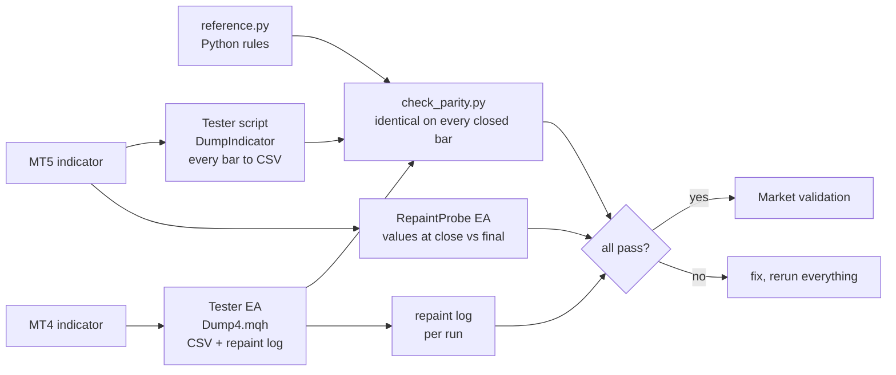


### Why the design cannot repaint

- The engine is fed only bars up to `rates_total - 2`, i.e. never the forming bar.
- A pivot is used only after its `right` confirming bars have closed. A swing can later be replaced by a more extreme
  one of the same type, but that only restarts the search for new candidates; a pattern that was already drawn stays.
- A pattern is drawn on the bar where it became known (the confirmation or completion bar), never back-dated, and
  never removed. Alerts fire only for the bar that just closed, only after the history load, once per bar, and never in
  the tester.

## Architecture and buffers

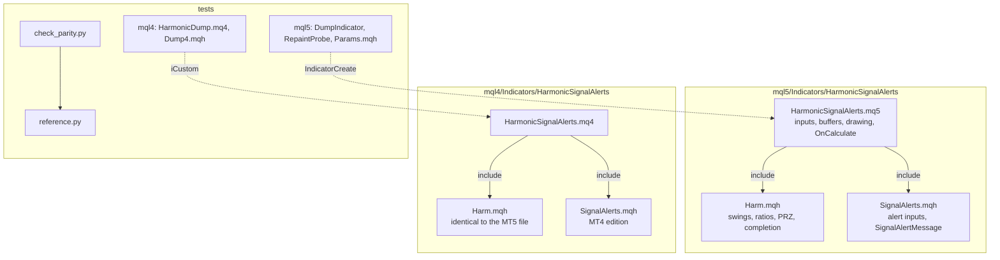

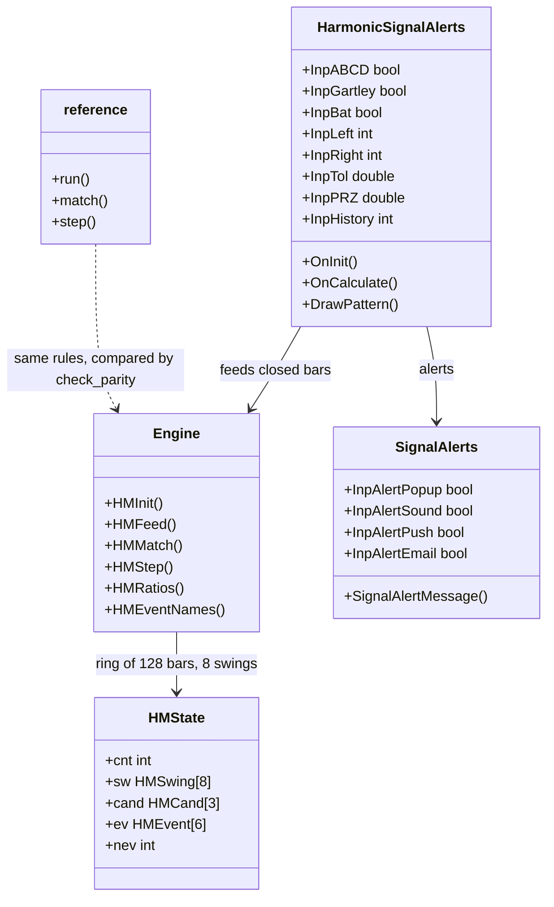

### `iCustom` buffer table (for EA developers)

| Buffer | MT5 | MT4 |
|---|---|---|
| 0 | **Bullish** arrow price (bar low on MT5, below it on MT4), empty otherwise | same |
| 1 | **Bearish** arrow price (bar high on MT5, above it on MT4), empty otherwise | same |
| 2 | bit mask of the bullish patterns on the bar (1 ABCD, 2 Gartley, 4 Bat) | same |
| 3 | bit mask of the bearish patterns on the bar | same |

Empty value is `EMPTY_VALUE`. Read arrows on **closed bars** (shift 1 and higher). `iCustom` parameters follow the input
order: ABCD, Gartley, Bat, swing left, swing right, tolerance, zone, history, lines, zone box, labels, bullish colour,
bearish colour, (MT4 only: arrow gap), pop-up, sound, sound file, push, e-mail. In MT5 the `input group` headings also
count as string parameters when you build a handle with `IndicatorCreate` (see `tests/mql5/Include/IndTest/Params.mqh` and
the strings in `tests/check_parity.py`).

## Inputs, alerts, install and compile

| Input | Default | Meaning |
|---|---|---|
| ABCD, Gartley, Bat | all on | Which patterns to look for |
| Swing: bars on the left / right | 10 / 5 | Pivot width. `right` is also the confirmation delay |
| Ratio tolerance, % | 5.0 | Widening of every ratio range |
| Reversal zone half-width, % of XA | 3.0 | PRZ half-width (ABCD: of AB) |
| Closed bars to scan on the chart | 3000 (100-20000) | How far back patterns are drawn |
| Draw the XABCD lines, the zone, labels | true | Display only |
| Bullish colour, Bearish colour | green, red | Look only |
| Arrow distance from the candle (MT4 only) | 0.3 x ATR(14) | MT4 cannot shift arrows by pixels |
| Pop-up alert | true | Terminal alert window |
| Play a sound / sound file | false / alert.wav | File from the terminal's Sounds folder |
| Push notification | false | Needs your MetaQuotes ID in Options |
| E-mail | false | Needs e-mail set up in Options |

**Install from source.** Copy `mql5/Indicators/HarmonicSignalAlerts/` into `<terminal data folder>/MQL5/Indicators/` (MT5) or
`mql4/Indicators/HarmonicSignalAlerts/` into `<data folder>/MQL4/Indicators/` (MT4), open the `.mq5` or `.mq4` in
MetaEditor and press Compile (F7). Both compile with 0 errors and 0 warnings (checked on a Windows machine with MetaEditor, from a clean scratch folder that holds only these files; the compiled files are not in
the repository). Keep the three files of each edition together: the indicator includes `Harm.mqh` and `SignalAlerts.mqh`
from its own folder.

## Run the Python reference and the tests

```bash
python3 -m venv .venv && . .venv/bin/activate && pip install -r requirements.txt
```

```python
import sys; sys.path.insert(0, "tests")
from reference import Params, run
# high, low, close are float lists of closed bars, oldest first
events = run(high, low, close, Params())   # each event: bar, dir (+1/-1), pat, x/a/b/c/d points, near, far
```

To repeat the parity check on your own data:

1. Compile the indicator and the test tool for your platform (`tests/mql5/Scripts/DumpIndicator`, or
   `tests/mql4/HarmonicDump.mq4` with `tests/mql4/Include/IndTest4/Dump4.mqh` in your `MQL4/Include/IndTest4/`; MT5 also
   needs `tests/mql5/Include/IndTest/Params.mqh`).
2. Run it in the Strategy Tester (MT4) or as a script (MT5) for each symbol and timeframe, with the input sets in
   `tests/configs.tsv` (MT5; the exact `InpParams` strings are in `tests/check_parity.py`) and `tests/mql4/configs.tsv`
   (MT4). The tool writes one CSV per symbol and timeframe into a `dump` folder.
3. `python3 tests/check_parity.py <folder that contains dump>` (add `--mt4` for MT4 dumps). It prints PASS or FAIL per
   file and an overall result.
4. Repaint: run `tests/mql5/Experts/RepaintProbe` in the MT5 Strategy Tester (every tick); the MT4 test EA writes its
   repaint log with the dump.

The price dumps used for the published numbers are not in this repository (they are broker price data).

## Honest limits

- **A harmonic pattern is not a strategy.** No stop-loss, position sizing or exit rules are provided or implied, and the
  rules were not optimised or back-tested for profit. Whether price reverses at a zone depends on the market, the stop
  you would use and your costs; a wider or narrower stop changes any result a lot.
- **No profit or accuracy claim is made.** The only numbers here are about *consistency* (the implementations agree,
  patterns do not move) and *frequency* (patterns per 1,000 bars).
- **Late by design.** A swing is known `right` bars after it formed, so a pattern appears a few bars after its turning
  points and never earlier. That delay is what makes it non-repainting.
- **Ratios and tolerances differ between authors.** These are commonly published values with a 5% tolerance; other tools
  differ, so counts will differ.
- **Rare.** About one pattern per 205 bars across the tested symbols, so most charts show none on screen.
- **Scope of the tests.** Four symbols on M15, H1 and H4 for the Market builds (the same calculation), the repository's input sets, one MT5 repaint run; the code in this repository has so far been compile-checked only, and the MT5 build was not run on a live chart as part of these numbers. Other symbols and timeframes are not covered by the published numbers.
- A multi-symbol scanner that watches patterns across many symbols exists as a separate paid product (see below).

## Free vs Pro

| | Free: Harmonic Signal Alerts | Paid: Harmonic Scanner |
|---|---|---|
| Platforms | MT5 [201811](https://www.mql5.com/en/market/product/201811), MT4 [202361](https://www.mql5.com/en/market/product/202361) | MT5 [201814](https://www.mql5.com/en/market/product/201814), MT4 (Pro) [202421](https://www.mql5.com/en/market/product/202421) |
| Price | free | paid (see the Market page) |
| What you get | ABCD, Gartley and Bat with lines, zone, arrow and alerts on the current chart, source here | A multi-symbol, multi-timeframe scanner, as described on its Market listing |
| Source | this repository | not published |
| Confirmed swings, closed bars, no repaint | yes | see its listing |

No need to buy the paid product to use the free one: the free indicator is complete on its own.
Website: [allanninal.dev/mql5](https://www.allanninal.dev/mql5/#indicators) ([MT4](https://www.allanninal.dev/mql5/#mt4)).

## Licence

Copyright 2026 Allan Niñal (<https://www.allanninal.dev/mql5>). Licensed under the
[PolyForm Noncommercial License 1.0.0](LICENSES/PolyForm-Noncommercial-1.0.0.md): source-available, free for personal
and other noncommercial use, not for commercial use. Each source file has an `SPDX-License-Identifier` line. Text:
[`LICENSE`](LICENSE). The harmonic ratios are the publicly published (Carney) definitions; the code is original and is not
a port of any TradingView script. The licence applies to this source, not to anything you build or trade with the
indicator. Trading involves risk; the software is provided as is.

---

**Website:** [allanninal.dev/mql5](https://www.allanninal.dev/mql5/#indicators) · [MT4](https://www.allanninal.dev/mql5/#mt4) · [allanninal.dev](https://www.allanninal.dev)
· Questions: message me on [LinkedIn](https://www.linkedin.com/in/allanninal/).
